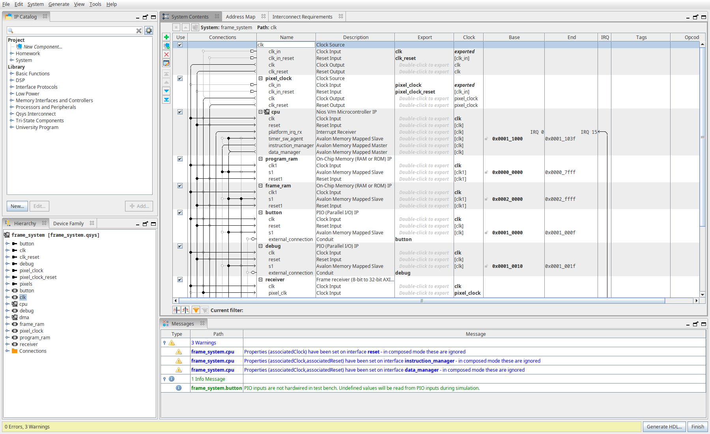
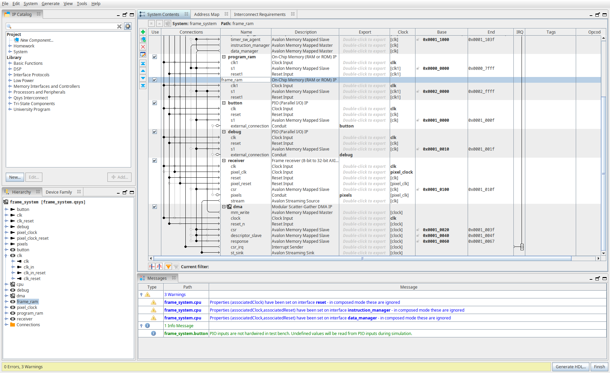
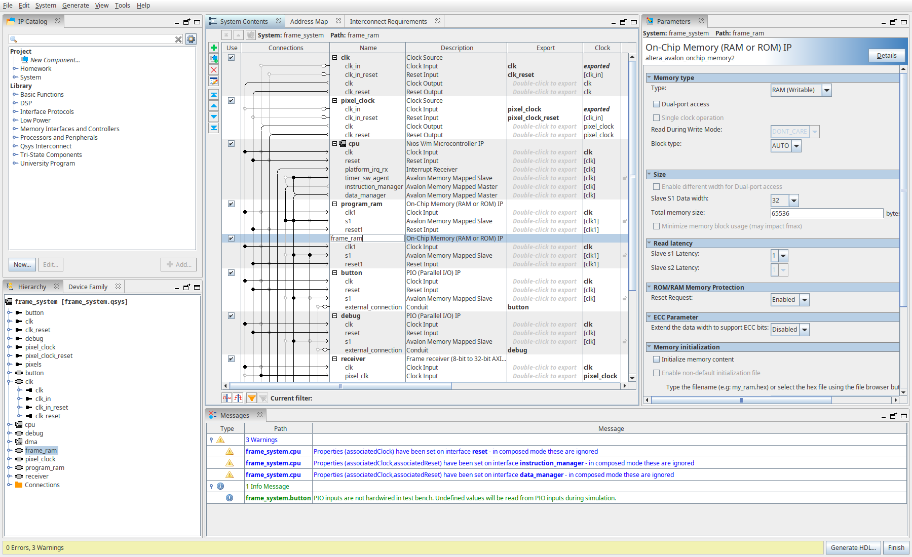
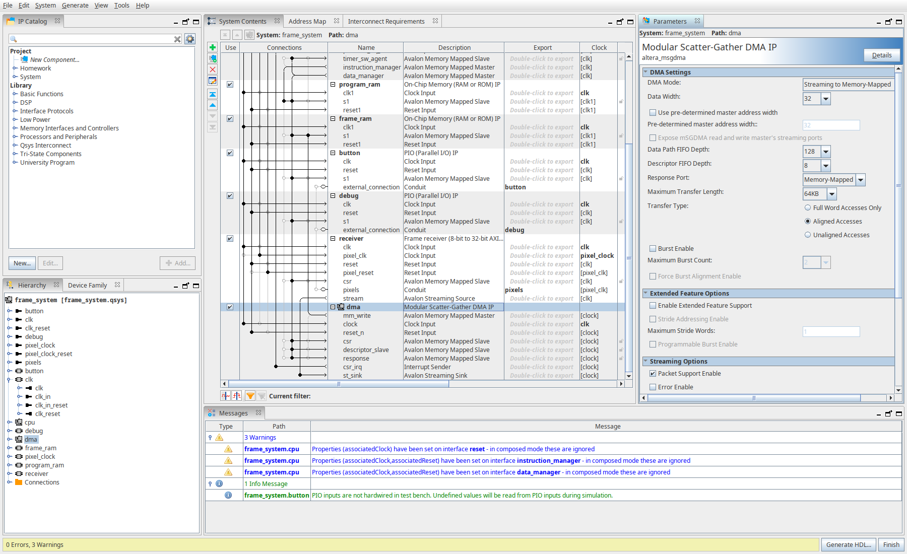
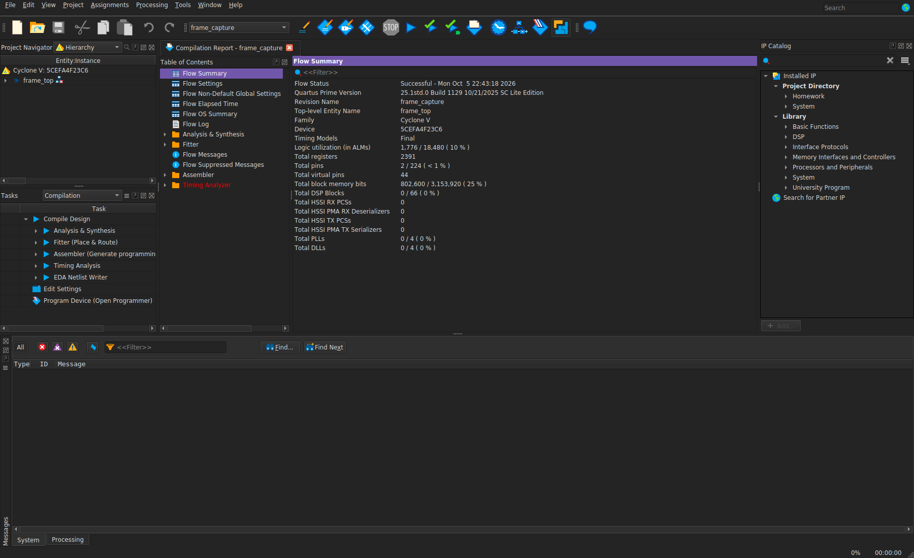
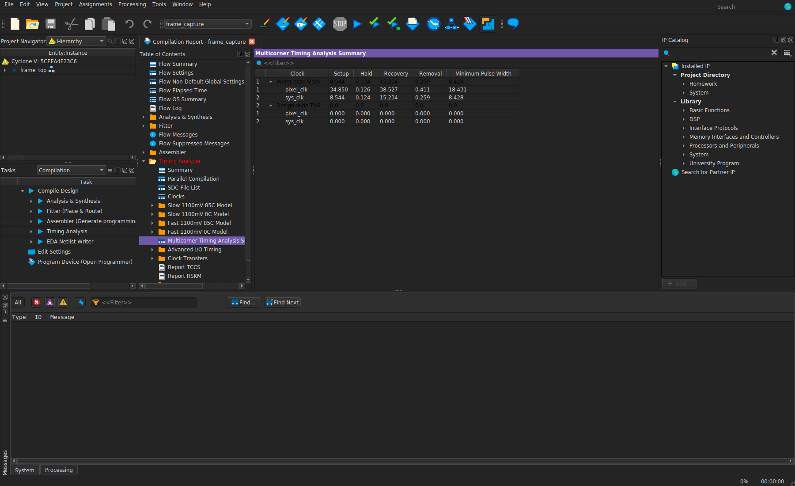
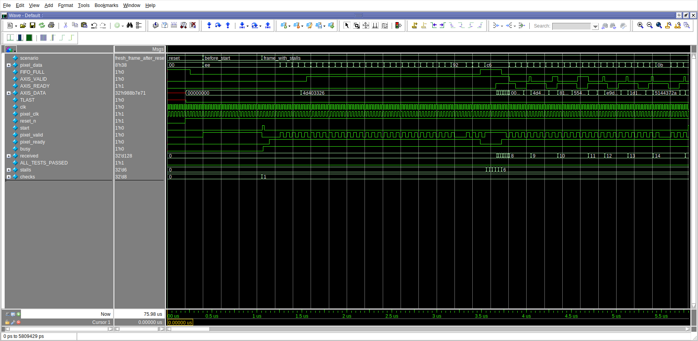
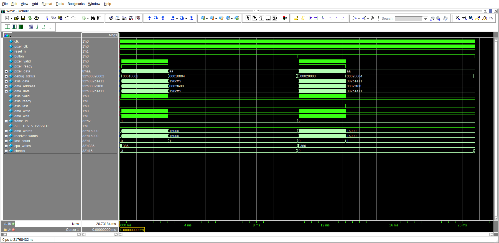
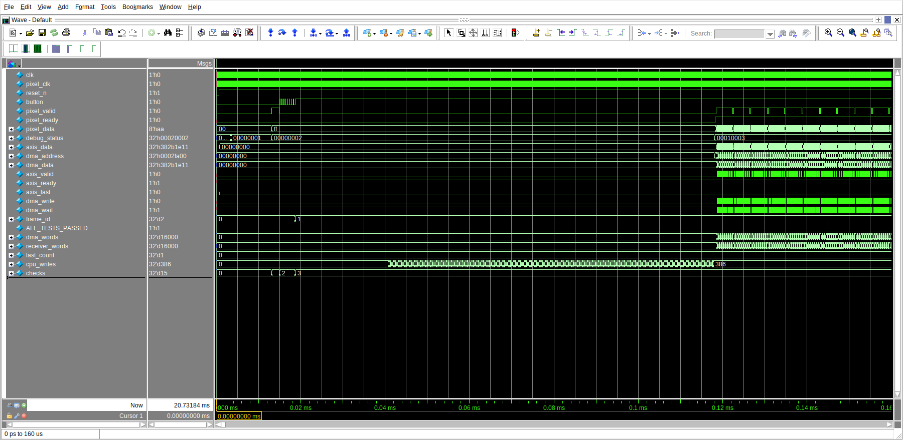

# Домашнє завдання — Заняття 12

Зроблено у Quartus Prime Lite 25.1 під Cyclone V (5CEFA4F23C6).
Симуляцію запускав у Questa Altera Starter 2025.2.
Плати немає, тому перевірка через симуляцію та повну компіляцію.

Замість компонентів Vivado використав такі:

- MicroBlaze → Nios V/m;
- AXI GPIO → Avalon PIO;
- AXI DMA S2MM → Modular Scatter-Gather DMA, Streaming to Memory-Mapped;
- axi4_full_ram → 32-бітна On-Chip RAM з Avalon-MM;
- Block Design → Platform Designer.

Власний приймач має AXI4-Stream вихід. У `frame_rx_component.sv` він підключається
до Avalon-ST входу mSGDMA через адаптер сигналів і порядку байтів.
Після натискання кнопки програма процесора налаштовує DMA та запускає прийом
одного кадру. Записує дані в RAM саме DMA.

Проєкт — [frame_capture.qpf](frame_capture.qpf), система — [frame_system.qsys](frame_system.qsys).
Код модулів лежить у `rtl/`, програма в `software/`, тестбенчі в `tests/`.

---

**1. Система з Nios V**

Тут зображено Nios V/m, RAM для програми, RAM для кадру та PIO кнопки.
Для процесора й DMA використовується clock 50 MHz, для зовнішніх пікселів — 25 MHz.
RAM програми має 32 KiB і містить код, отриманий з ELF.



---

**2. Приймач і DMA**

Тут нижня частина тієї самої системи. Власний `receiver` має два clock,
зовнішній порт `pixels`, регістри керування `csr` та потоковий вихід `stream`.
Він з'єднаний із `dma.st_sink`, а `dma.mm_write` — з RAM кадру.
Процесор має доступ до керування DMA, дескриптора, відповіді та RAM.



Карта адрес:

| Блок | Адреса |
|---|---|
| RAM програми | `0x00000000`–`0x00007FFF` |
| PIO кнопки | `0x00010000` |
| PIO статусу | `0x00010010` |
| DMA CSR | `0x00010020` |
| DMA descriptor | `0x00010040` |
| DMA response | `0x00010060` |
| Receiver CSR | `0x00010100` |
| RAM кадру | `0x00020000`–`0x0002FFFF` |

---

**3. Об'єм RAM для кадру**

Один піксель — один байт. Чотири послідовні пікселі пакуються в одне 32-бітне слово:
перший у біти 7:0, другий у 15:8, третій у 23:16, четвертий у 31:24.

```text
320 × 200 = 64000 пікселів = 64000 байтів
64000 / 4 = 16000 слів по 32 біти
RAM: 65536 байтів = 16384 слова
Залишок: 1536 байтів = 384 слова
```

Тут видно налаштування RAM: ширина 32 біти та розмір 65536 байтів.
Тобто пам'яті вистачає на весь кадр. Залишок використовую як захисну ділянку
в перевірці, DMA туди записувати не повинен.



---

**4. Налаштування DMA**

Вибрав Streaming to Memory-Mapped, 32-бітні дані, підтримку пакетів,
максимальну довжину 65536 байтів та MM response port.
Для кадру програма передає один дескриптор: адреса `0x20000`, довжина 64000 байтів.
Контрольне поле з GO записується останнім, потім запускається приймач.



---

**5. Повна компіляція**

Тут видно результат повної компіляції Quartus: Successful,
1776 ALM, 2391 регістр та 802600 біт блокової пам'яті.
Помилок немає, попередження інструментів залишені в логах.
Піни даних задані як virtual pins, бо конкретної плати немає.



---

**6. Timing для двох частот**

У SDC задані два clock: 20 ns і 40 ns. Вони позначені як асинхронні,
дані між ними проходять через dual-clock FIFO, а керування — через синхронізатори.

| Clock | Найгірший setup slack | Найгірший hold slack |
|---|---:|---:|
| sys_clk, 50 MHz | +8,544 ns | +0,124 ns |
| pixel_clk, 25 MHz | +34,850 ns | +0,126 ns |

Тут зображено Multicorner Timing Analysis Summary після Fitter.
Зовнішні I/O delay та розводка плати не перевірялися.



---

**7. Перевірка**

Вхідні порти: `pixel_clk`, `pixel_data[7:0]`, `pixel_valid`, `pixel_ready`.
Байт приймається на фронті `pixel_clk`, коли `valid` і `ready` дорівнюють 1.
Якщо `ready = 0`, джерело має утримувати байт і `valid`, доки приймач його не прийме.
До старту і після останнього байта `ready = 0`, дані ігноруються.

Після пакування слово разом із SOP та TLAST проходить через Intel `dcfifo`.
Робочий FIFO має 256 слів по 34 біти: дані плюс дві ознаки.
На AXI4-Stream виході `TKEEP = 1111`, TLAST виставляється на останньому слові.
Розмір кадру кратний чотирьом, часткових слів тут немає.

В окремому тесті використав коротший кадр 512 байтів і FIFO на 8 слів,
щоб навмисно його заповнити. Частоти різні: 50 MHz і приблизно 29,412 MHz.
Тут видно FIFO_FULL, зниження `pixel_ready` та незмінний AXIS_DATA,
поки AXIS_READY дорівнює нулю.

Перевірено 256 слів у двох кадрах, порядок байтів, SOP/TLAST, паузи входу,
старт під час зайнятості та reset посеред слова. Усі 8 перевірок пройшли.



---

**8. Повна система з програмою процесора**

Тут симуляція всієї згенерованої системи, з реальними IP Nios V та mSGDMA.
У RAM програми завантажений образ машинного коду зі `software/simulation.elf`.
Процесор сам читає кнопку, записує дескриптор DMA та команду старту приймача.
Тестбенч ці регістри замість процесора не записує.

Два повних кадри мають різні дані. Для кожного перевірено:

- 16000 послідовних адрес і 32-бітних значень на виході DMA;
- 64000 байтів у completion response;
- рівно один TLAST;
- усі 16000 слів RAM програмою процесора;
- незмінність усіх 384 захисних слів;
- ігнорування зайвих байтів після кадру;
- відсутність повторного старту від утримання кнопки.

CPU перед DMA записує тільки 386 захисних маркерів: 384 після кадру та по одному
в перше й останнє слово. Під час прийому CPU дані кадру в RAM не копіює.
На скріні видно два інтервали DMA, лічильники до 16000 та кінцеві
`checks = 15`, `ALL_TESTS_PASSED = 1`.



---

**9. Старт після кнопки**

Тут збільшив початок симуляції. До натискання вхідні дані ігноруються,
короткі імпульси кнопки також не запускають прийом.
Програма вимагає 32 послідовні читання однакового рівня кнопки.
Після стійкого натискання з'являється `pixel_ready`, потім починаються записи DMA.
Для наступного кадру кнопку потрібно відпустити та натиснути ще раз.
Це коротка фільтрація імпульсів, для реальної механічної кнопки час debounce
потрібно підібрати під плату.



Статус у PIO: молодші 16 біт — стан, старші — номер кадру:
1 — очікування відпускання, 2 — очікування натискання, 3 — DMA/прийом,
4 — DMA завершив запис, 5 — перевірка завершена. `0xDEADxxxx` означає помилку.

---

**10. Файли програми та логи**

Одна програма `software/main.c`, два варіанти збірки:

- `hardware.elf` приймає довільні 8-бітні пікселі;
- `simulation.elf` додатково перевіряє відомий тестовий шаблон усіх пікселів.

Тестовий шаблон: `pixel[i] = (13*i + 7 + 31*frame_number) mod 256`.
ELF зібрані через Clang/LLVM для RV32I, HEX/DAT отримані з ELF через binary image.
Перевірка конвертації звіряє binary з ELF PT_LOAD. У симуляції виконуються
саме інструкції процесора, а не модель C-програми.
