# Домашнє завдання — Заняття 14 (ILA, VIO)

Зроблено у Quartus Prime Lite 25.1 під Cyclone V (5CEFA4F23C6).
Виконав **варіант Б**, плати немає. Симуляція — Questa Altera Starter 2025.2.

Взяв контролер замка із заняття 7, код 5 → 3 → 7, і додав налагодження.
Замість компонентів Vivado використав такі:

- ILA → Signal Tap Logic Analyzer;
- VIO → In-System Sources and Probes;
- Synthesis / Implementation → Analysis & Synthesis / Fitter;
- Generate Bitstream → Assembler, файл `.sof`.

Проєкт — [lock_debug.qpf](lock_debug.qpf), IP — [debug_ip.qsys](debug_ip.qsys),
налаштування аналізатора — [lock_debug.stp](lock_debug.stp).
[Умова завдання](TASK.md). Плату не програмував, захоплення через JTAG немає.

---

**1. Налаштування Signal Tap**

Тут налаштоване ядро: 13 біт даних, 13 біт тригера, буфер на 512 відліків
і три рівні тригера. Storage Qualifier підключений до вхідного порту,
запис пропусків даних увімкнений.

П'ять проб об'єднані в одну шину для Data і Trigger:

| Проба | Сигнал | Ширина | Біти шини |
|---|---|---:|---|
| probe0 | digit, вибрана цифра | 4 | 3:0 |
| probe1 | digit_clean, після debounce | 4 | 7:4 |
| probe2 | state | 2 | 9:8 |
| probe3 | next_state | 2 | 11:10 |
| probe4 | unlocked_led | 1 | 12 |

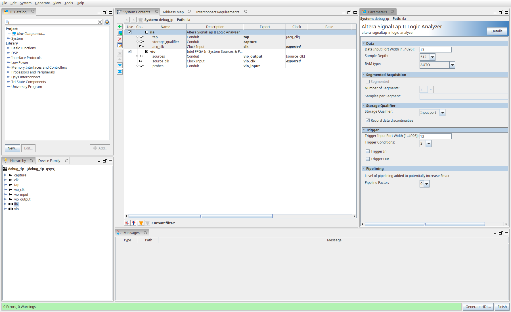

---

**2. Налаштування VIO**

Тут In-System Sources and Probes з ID `LOCK`: 13 біт для читання проб
і 7 біт керування. Source Clock підключений до clock проєкту.

- 3:0 — цифра з VIO;
- 4 — reset;
- 5 — вибір VIO замість зовнішнього `digit_in`;
- 6 — дозвіл запису Signal Tap.

Початкове значення `0x40` дозволяє запис і залишає зовнішній вхід.
Значення `0x65`, `0x63`, `0x67` подають через VIO код 5 → 3 → 7,
а `0x70` вмикає reset.

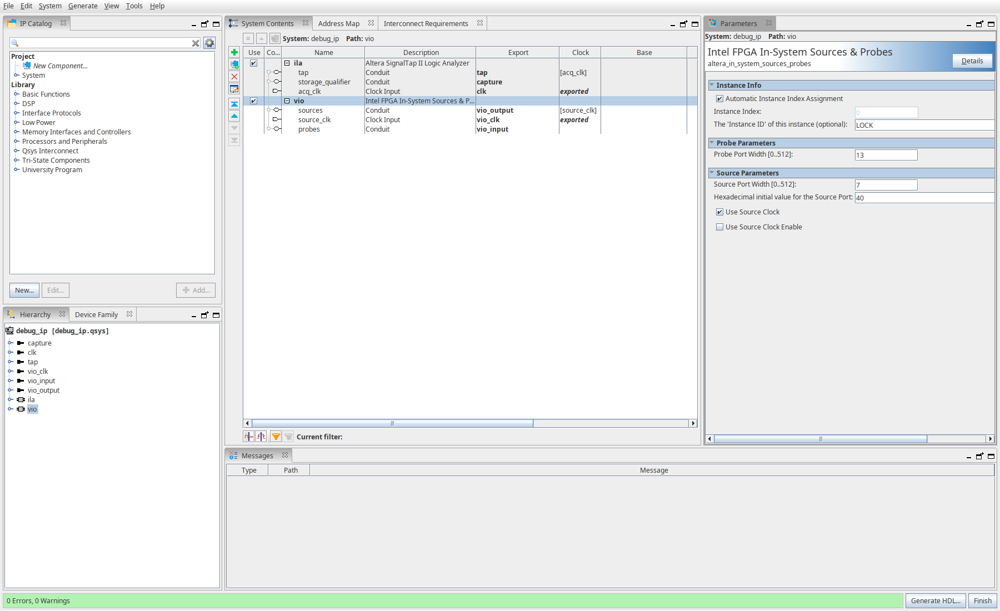

---

**3. Підключення в коді**

Тут `debug_top.sv`: вручну інстанціював `ila_0` і підключив п'ять проб.
У `ila_0.sv` вони об'єднуються та йдуть до Signal Tap і VIO.

У контролері залишив чотири стани, три окремі always-блоки,
асинхронний reset і debounce. Додав вихід `debug_word` для внутрішніх сигналів.

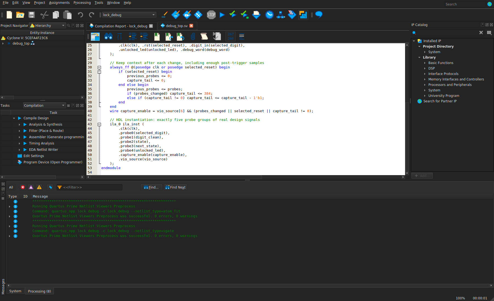

---

**4. Компіляція**

Проєкт пройшов Analysis & Synthesis, Fitter, Timing Analysis та Assembler.
На скріні статус Successful, 384 ALM, 796 регістрів і 7168 біт блокової пам'яті.
Помилок немає, є 3 попередження — вони залишені в логах.

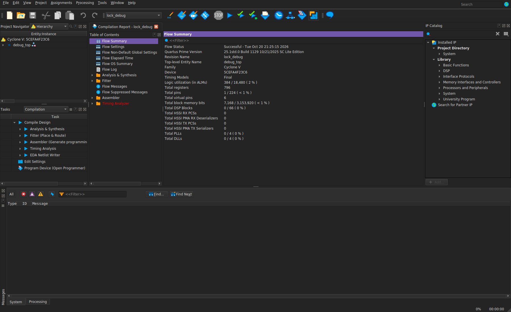

---

**5. Схема після Fitter**

Тут Technology Map Viewer у режимі Post-Fitting.
У Netlist Navigator видно `ila_0:ila_inst` і контролер замка.

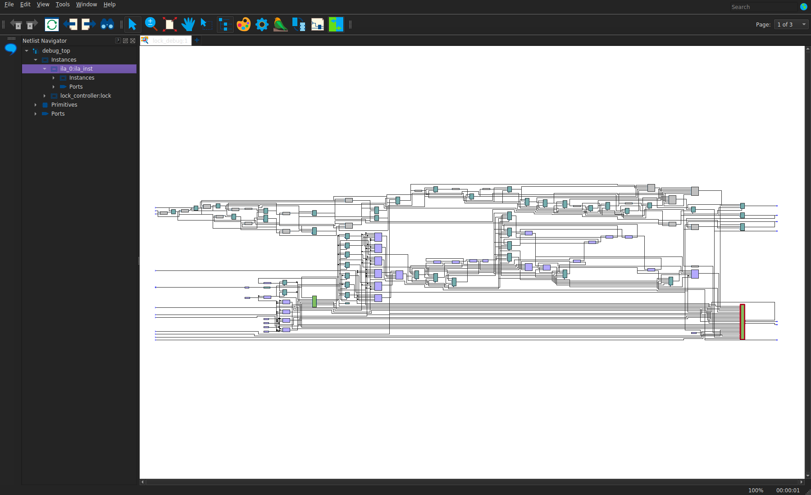

---

**6. RTL-схема**

Тут видно контролер, `ila_0`, вибір джерела цифри та дозвіл запису.

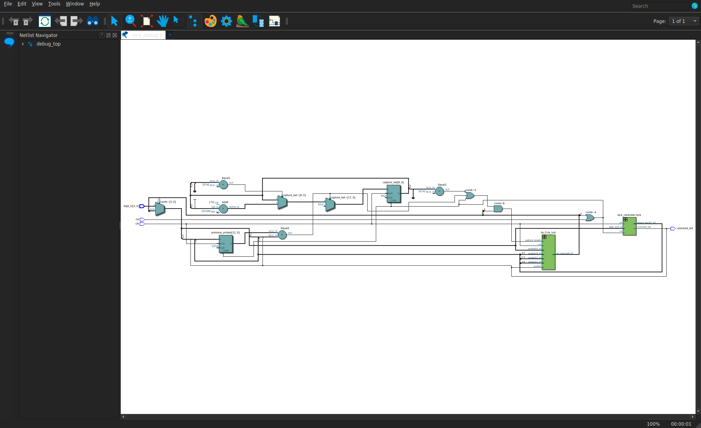

А тут розкритий `ila_0`: п'ять входів, шина на 13 біт,
Signal Tap (`sld_signaltap:ila`) та VIO (`altsource_probe_top:vio`).

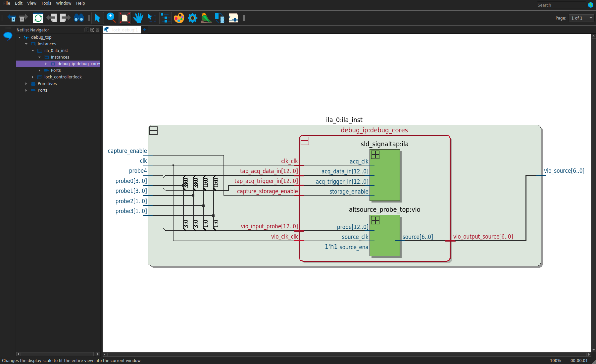

---

**7. Тригер і Capture Control**

Налаштував послідовний тригер Sequential, положення Center:

```text
1. state == WAIT_D2 (1)
2. state == WAIT_D3 (2)
3. rising edge unlocked_led
```

Тобто тригер спрацьовує на відкриття після введення коду.
Запис дозволений при зміні проб і ще 384 такти після останньої зміни
(7,68 μs при 50 MHz). Цього вистачає на контекст після тригера
для буфера 512 відліків. Довгі незмінні проміжки пропускаються.
Бітом 6 VIO можна зупинити запис, FSM продовжує працювати.

На скріні верхні п'ять груп — дані, нижні — умови тригера.
Видно `1h`, `2h` і фронт `Rb`. Статус `No devices detected` — бо плати немає.

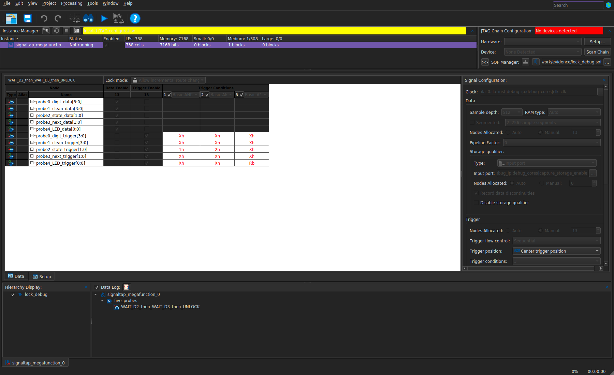

---

**8. Симуляція**

Тут Questa з `debug_top` і тими самими пробами.
У тестбенчі debounce скорочений до 4 тактів; для FPGA — 500000 тактів при 50 MHz.

Перевірив неправильний код, правильний код із `digit_in`, керування та reset
через VIO, зупинку і поновлення запису. У результаті **20 перевірок пройдено**,
3 відкриття замка, `ALL_TESTS_PASSED = 1`.
`qualified_samples = 1697` — сума відібраних відліків за весь тест.

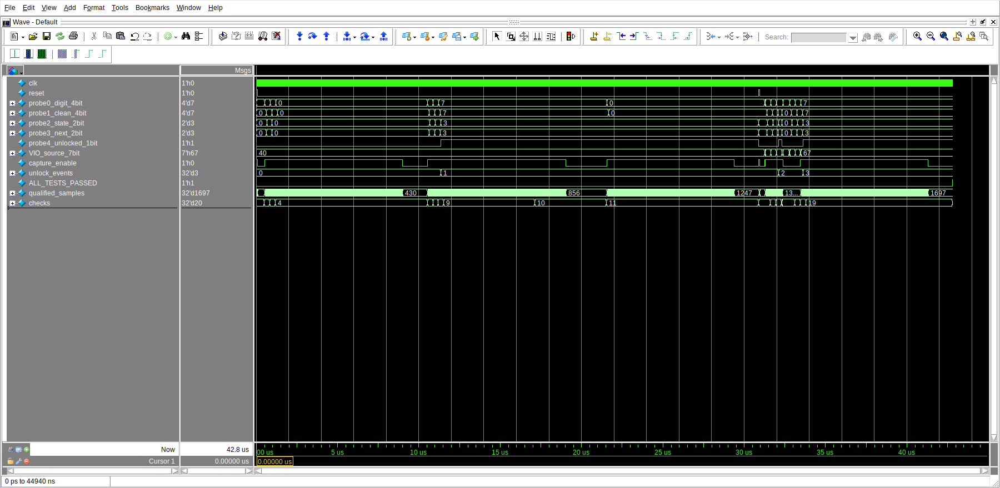

---

**9. Відкриття замка**

Тут збільшений фрагмент WAIT_D2 → WAIT_D3 → UNLOCKED, фронт LED
та `capture_enable`. Дозвіл запису тримається ще після відкриття,
потім вимикається, а замок залишається відкритим до reset.

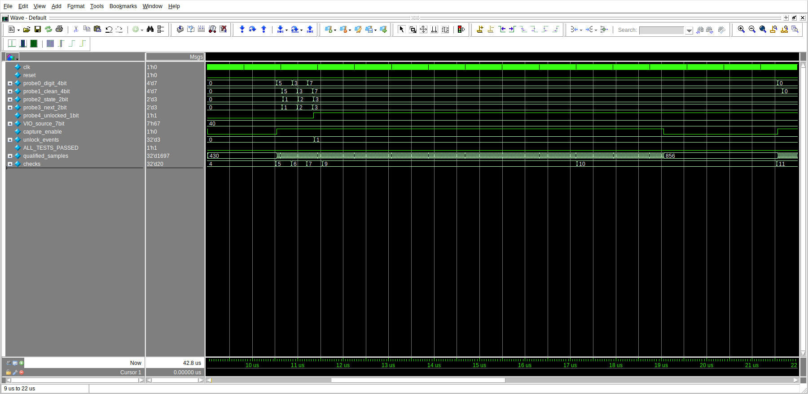

У тесті вектор VIO задається через `force`. Перевірені FSM, підключення проб,
керування та дозвіл запису. Сам буфер Signal Tap і передавання через JTAG
не симулювалися.

Для сумісності моделей Quartus 25.1 скрипт `prepare_simulation.py` узгоджує
параметри й порти у згенерованих файлах симуляції. Файли для синтезу та
встановлені бібліотеки Quartus залишаються без змін.

---

**10. Timing**

Заданий clock 50 MHz. Тут додатний setup і hold slack для `sys_clk`
і JTAG clock `altera_reserved_tck`:

| Clock | Setup slack | Hold slack |
|---|---:|---:|
| sys_clk | +14,205 ns | +0,147 ns |
| altera_reserved_tck | +9,151 ns | +0,137 ns |

Піни даних virtual, прив'язки до плати та зовнішніх I/O delay немає.

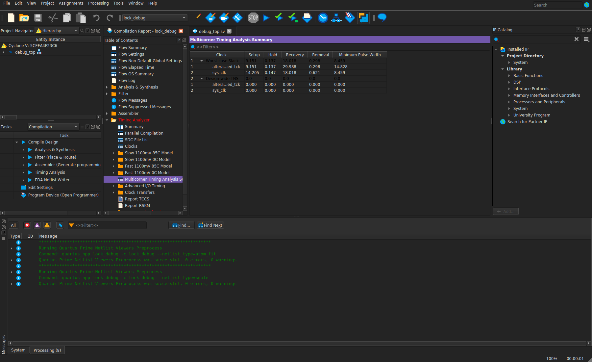

---

**11. Результати**

Assembler створив [lock_debug.sof](evidence/lock_debug.sof) для Cyclone V 5CEFA4F23C6.
[Контрольна сума](evidence/logs/bitstream_sha256.txt),
[лог симуляції](evidence/logs/simulation.log),
[waveform WLF](evidence/debug_simulation.wlf).

