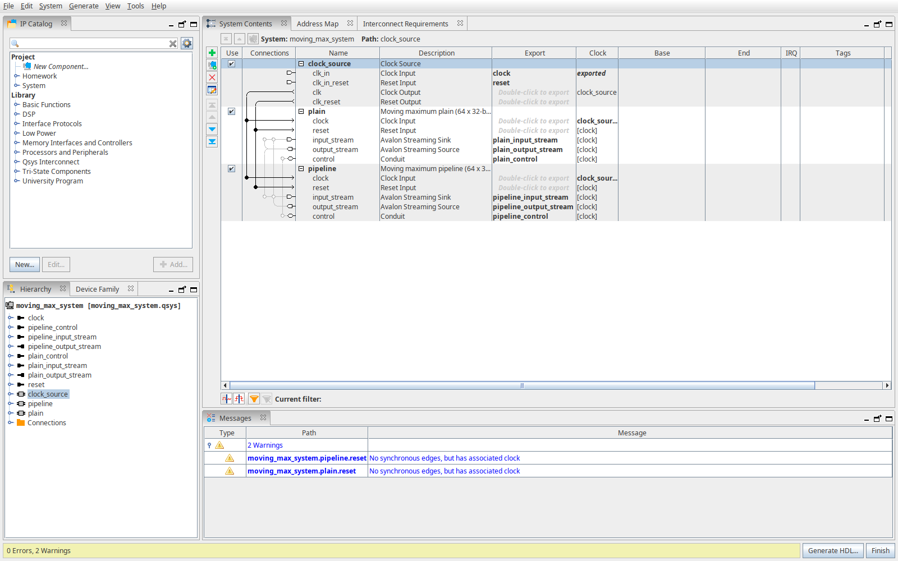
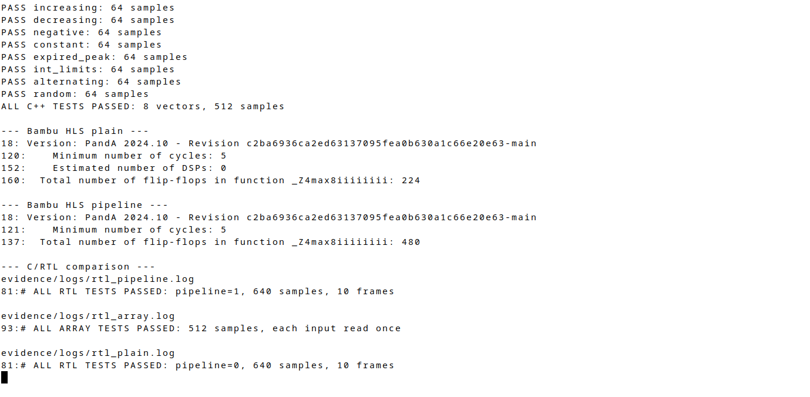
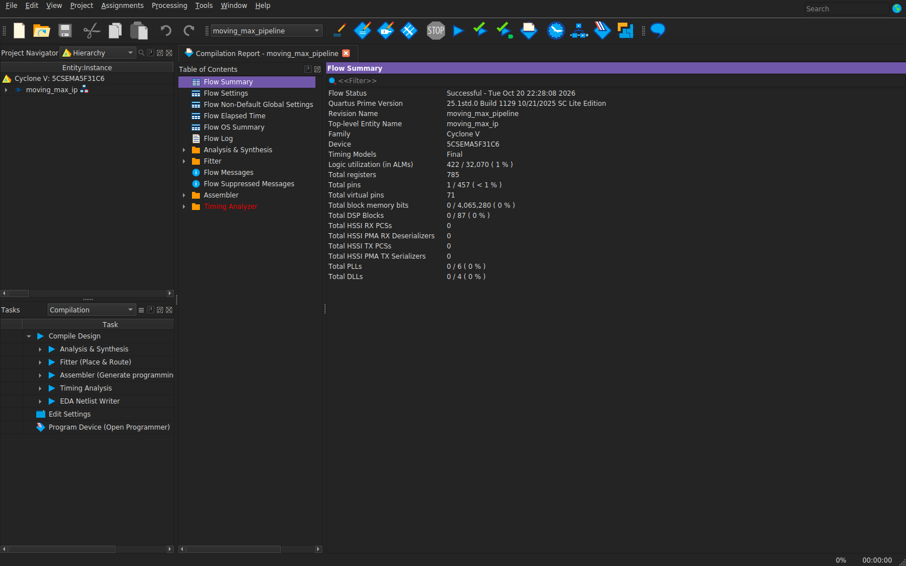
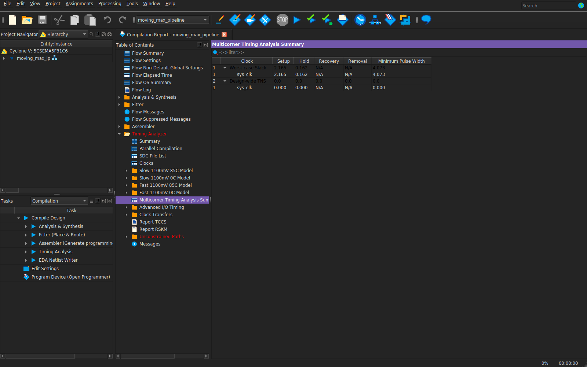
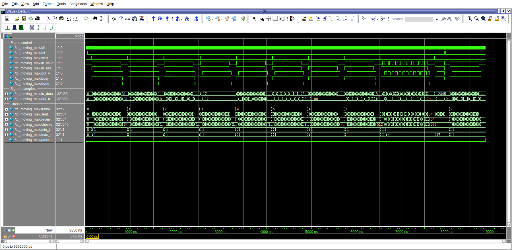
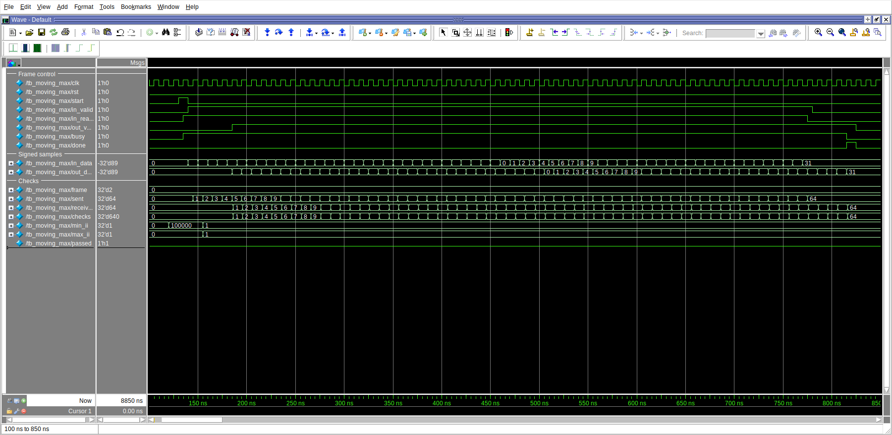
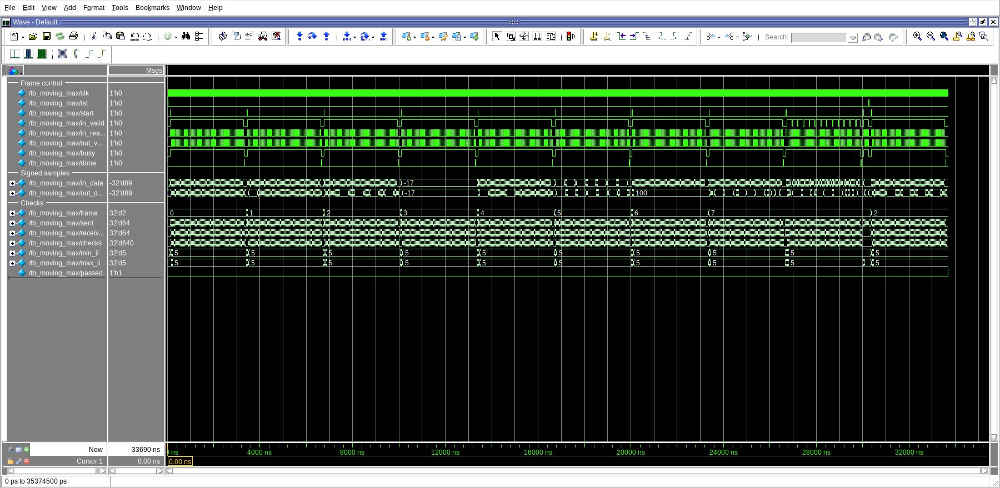
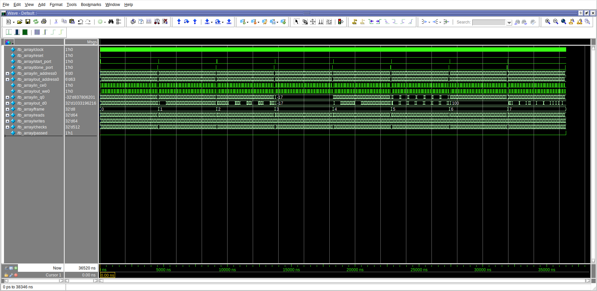

# Домашнє завдання — Заняття 15 (ковзний максимум)

Зроблено у Quartus Prime Lite 25.1 під Cyclone V (5CSEMA5F31C6).
Замість Vitis HLS використав Bambu HLS 2024.10, симуляція — Questa 2025.2.
Плати немає, перевірка через симуляцію та збірку проєктів.

Функція бере 64 числа й шукає максимум із поточного та семи попередніх.
Для перших семи враховуються тільки наявні числа. Вхід читається один раз,
дані — signed 32-bit.

Bambu не підтримує конвеєризацію цього циклу, тому конвеєризував C++ ядро
`max8`, а вікно зберігається у спільному `moving_max_ip.sv`.
Повна масивна функція `moving_max` згенерована окремо, без конвеєра.
Це адаптація під Quartus, конвеєризація циклу у Vitis не виконувалася.

Проєкти: [plain](plain/moving_max_plain.qpf),
[pipeline](pipeline/moving_max_pipeline.qpf),
[масивна функція](array_hls/moving_max_array.qpf).

---

**1. IP у Platform Designer**

Тут обидва IP: вхід і вихід Avalon Streaming та керування `start/busy/done`.
Перед блоком подається імпульс `start`, потім 64 числа через valid/ready.
Результати йдуть з `out_valid`, після останнього — `done`.
Приймач виходу має бути завжди готовим.



[Система](moving_max_system.qsys), [архів IP](evidence/moving_max_ip.zip).
Для додавання компонентів в інший проєкт розпакувати архів і додати його `ip/`
до IP Search Path.

---

**2. C++ тести та HLS**

Тут перевірка 8 наборів по 64 числа: зростання, спадання, від'ємні, константа,
вихід піка з вікна, межі `int`, чергування й випадкові числа.
Еталон рахує максимум прямим перебором. Усі 512 результатів збігаються.

Обидва ядра синтезувалися з бюджетом 5 ns. Plain — без директив,
pipeline — з `#pragma HLS pipeline II=1`.

| Версія | Затримка ядра, тактів | Оцінка FF у HLS | DSP |
|---|---:|---:|---:|
| plain | 5 | 224 | 0 |
| pipeline | 5 | 480 | 0 |



---

**3. Компіляція plain**

Тут повна компіляція без конвеєра. Статус Successful, 425 ALM та 803 регістри.


---

**4. Компіляція pipeline**

Тут конвеєрна версія з тією самою обгорткою. Обидва проєкти зібрані до `.sof`.
Після Fitter отримав такі результати для всього IP:

| Версія | ALM | ALUT для логіки | Регістри | DSP | Тактів на 64 числа |
|---|---:|---:|---:|---:|---:|
| plain | 425 | 316 | 803 | 0 | 320 |
| pipeline | 422 | 315 | 785 | 0 | 68 |

Час виміряний від першого прийнятого числа до останнього результату, без пауз.
ALUT — показник Quartus для логіки; оцінка FF вище стосується тільки HLS-ядра
до оптимізації. Помилок збірки немає, попередження залишені в логах.



---

**5. Timing**

Заданий однаковий clock 100 MHz, період 10 ns. Slack додатний:

| Версія | Setup slack | Hold slack |
|---|---:|---:|
| plain | +2,823 ns | +0,136 ns |
| pipeline | +2,165 ns | +0,162 ns |

Піни даних virtual, прив'язки до плати й зовнішніх I/O delay немає.



---

**6. Симуляція pipeline**

Тут RTL порівнюється з еталоном із C++ через файли `vectors.hex` та `expected.hex`.
Перевірені всі набори, паузи на вході та reset посеред блока.
У кожної версії **640 успішних порівнянь**, `passed = 1`.



---

**7. Один блок з II=1**

Тут збільшений фрагмент: нове число приймається кожного такту,
лічильники `sent` і `received` доходять до 64. Для plain інтервал — 5 тактів.



---

**8. Симуляція plain**

Тут ті самі дані без конвеєра. На `in_ready` видно очікування між обчисленнями.



---

**9. Повна масивна функція**

Тут Verilog-тест повної `moving_max` із RAM-інтерфейсами: **512 успішних
порівнянь**, кожна вхідна адреса читається один раз. Блок займає 449 тактів
від запуску. Проєкт зібрався: 435 ALM, 327 ALUT, 631 регістр і 0 DSP.



---

Збірка й тести з цієї папки, коли Quartus, Questa та g++ доступні у PATH:

```bash
bash scripts/run_tests.sh
bash scripts/build.sh
```

Для Questa потрібна власна ліцензія через `SALT_LICENSE_SERVER` або `SALT_LICENSE_FILE`.
Verilog уже згенерований. Повторна генерація з C++ — через `scripts/generate_hls.sh`,
змінна `BAMBU` має вказувати на виконуваний файл Bambu 2024.10.

Перегляд збереженої симуляції:

```bash
vsim -gui -view evidence/pipeline_simulation.wlf -do scripts/view_stream.do
```

[Логи](evidence/logs/), [звіти](evidence/reports/),
[такти plain](evidence/plain_cycles.csv), [такти pipeline](evidence/pipeline_cycles.csv).
Бази Quartus і робочі файли симулятора виключені через `.gitignore`.
