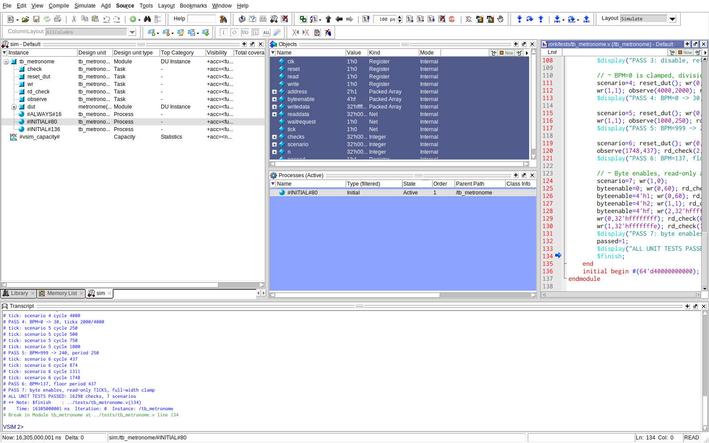
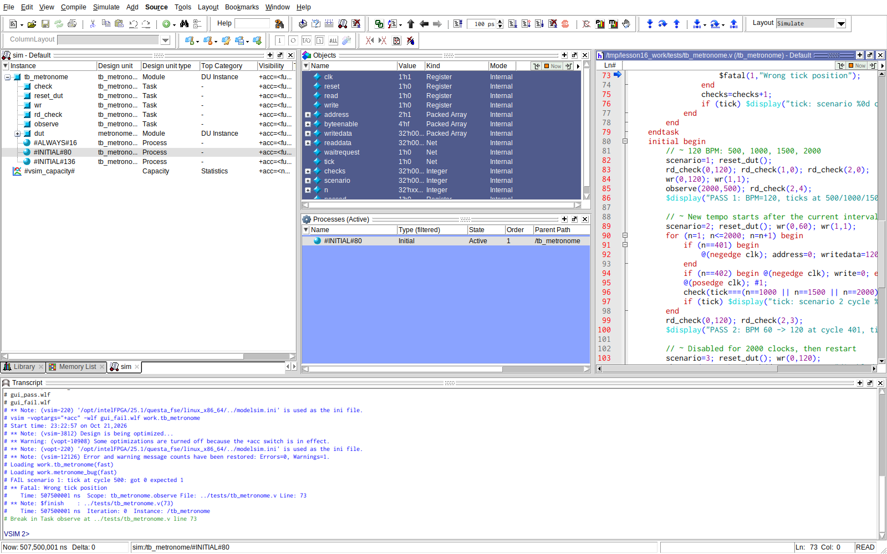
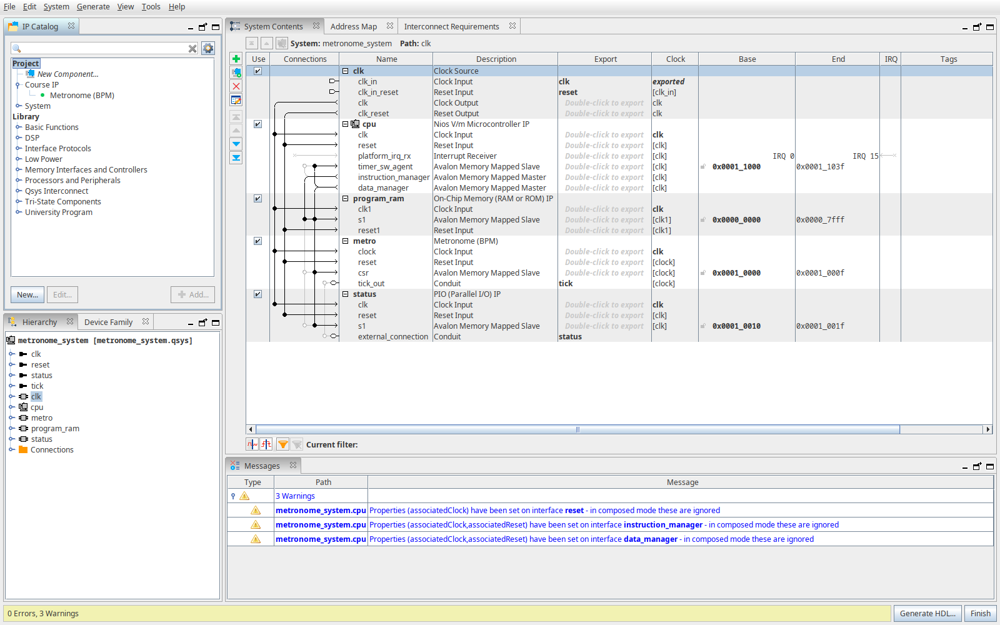
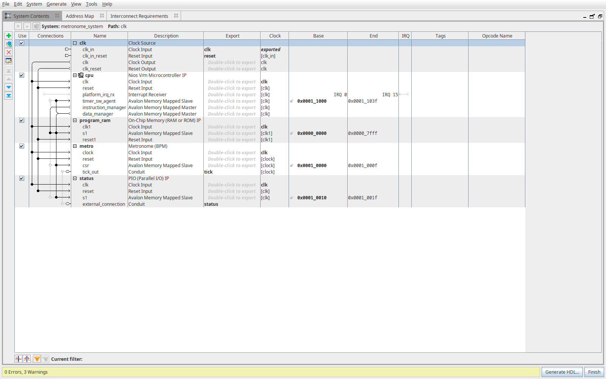
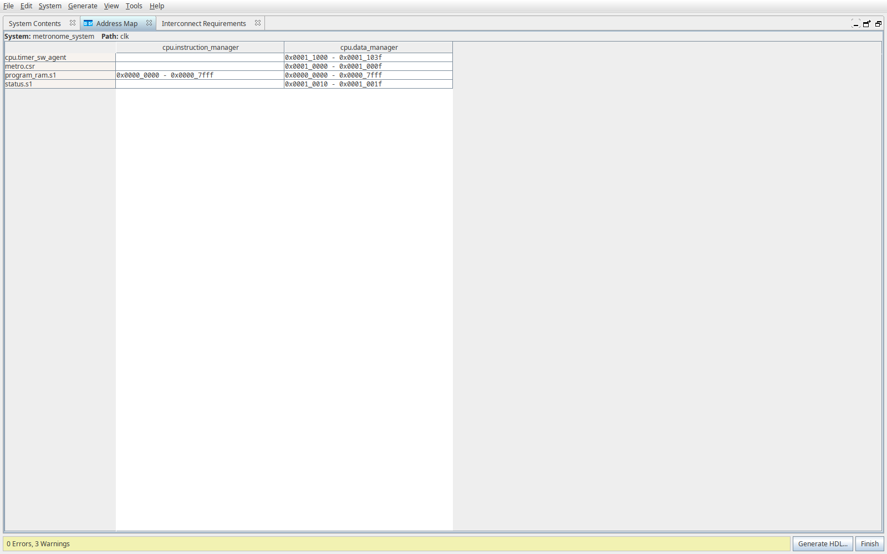
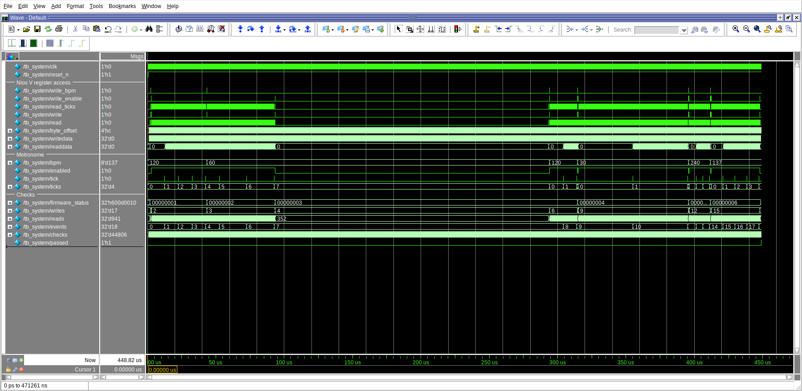
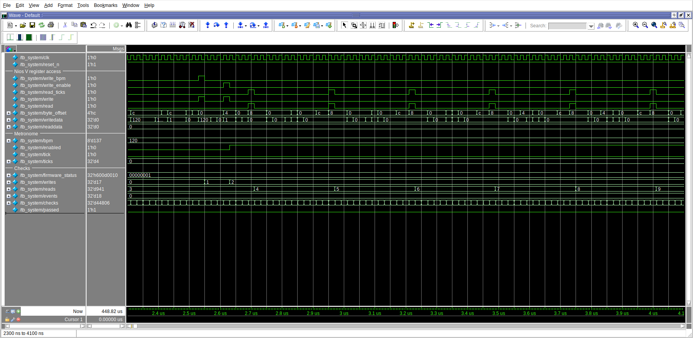
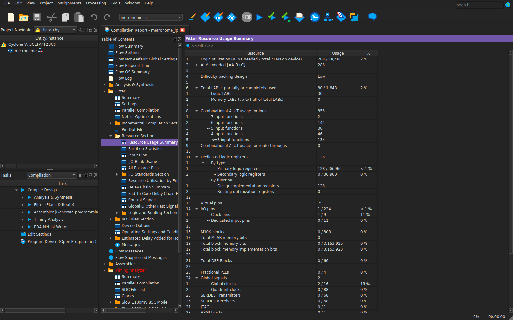
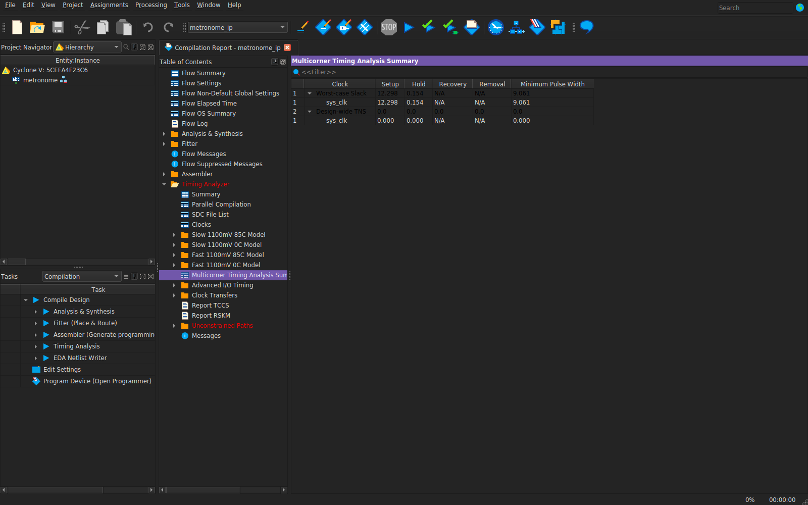
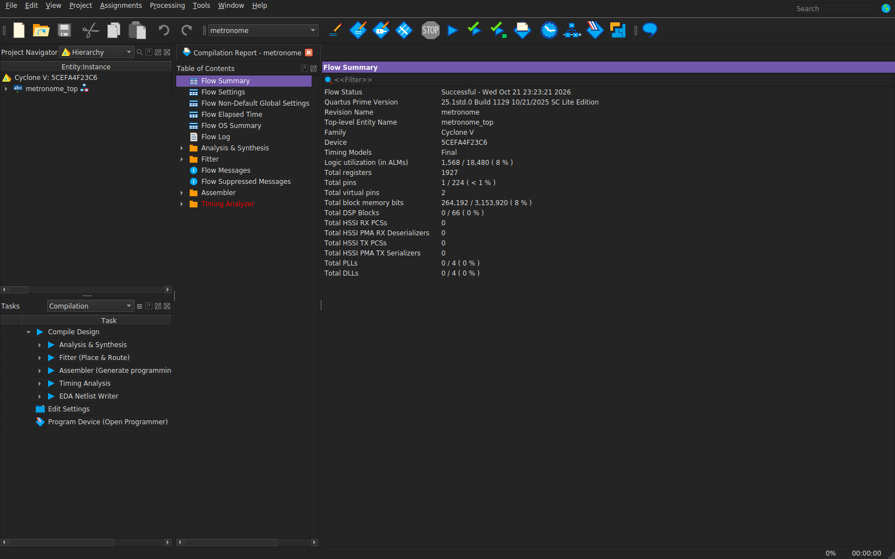

# Курсовий проєкт — Метроном

Тема 5. Зроблено у Quartus Prime Lite 25.1 під Cyclone V (5CEFA4F23C6).
Симуляція — Questa 2025.2. Плати немає, перевірка через симуляцію та збірку.

Замість MicroBlaze використав Nios V/m, замість AXI4-Lite — Avalon-MM.
Block Design — це Platform Designer, Package IP — компонент `_hw.tcl`,
Implementation — Fitter, WNS — найгірший setup slack у Timing Analyzer.
C-програма збирається Clang/LLVM у RISC-V ELF.

Проєкти: [система з Nios V](metronome.qpf),
[окремий метроном](ip_only/metronome_ip.qpf).

---

**1. Модуль і регістри**

Метроном видає `tick` на один такт. Період у тактах:
`floor(CLK_HZ × 60 / BPM)`. Ділення округлюється вниз,
таблиця періодів розраховується під час синтезу.

Базова адреса IP — **0x10000**, регістри 32-бітні.

| Зсув | Назва | Доступ | Значення |
|---|---|---|---|
| 0x00 | BPM | R/W | Темп 30–240. Менші значення стають 30, більші — 240 |
| 0x04 | ENABLE | R/W | Біт 0 вмикає метроном, інші біти читаються як 0 |
| 0x08 | TICKS | R | Кількість імпульсів після останнього ввімкнення |

Після reset: BPM=120, ENABLE=0, TICKS=0. Новий BPM читається одразу,
а період змінюється після поточного інтервалу.
При вимкненні лічильник тактів утримується в нулі, TICKS зберігається.
Нове ввімкнення обнуляє TICKS і починає повний інтервал спочатку.
Запис у TICKS ігнорується, адреса 0x0C повертає 0. Є підтримка `byteenable`.

Код: [metronome.v](ip/metronome.v), [опис IP](ip/metronome_hw.tcl).

---

**2. Тест модуля**

Очікувані числа пораховані до запуску. CLK_HZ=1000,
такт 1 — перший фронт після запису ENABLE=1.

| Сценарій | Розрахунок | Такти tick |
|---|---|---|
| BPM=120, 2000 тактів | 60000/120=500 | 500, 1000, 1500, 2000; TICKS=4 |
| BPM=60, на такті 401 записати 120 | Перший інтервал 1000, наступні 500 | 1000, 1500, 2000; TICKS=3 |
| ENABLE=0 протягом 2000, потім 1, BPM=120 | Без імпульсів, потім період 500 | Від ввімкнення 500, 1000; TICKS=2 |
| BPM=0 | Обмеження до 30, 60000/30=2000 | 2000, 4000; TICKS=2 |
| BPM=999 | Обмеження до 240, 60000/240=250 | 250, 500, 750, 1000; TICKS=4 |
| BPM=137 | floor(60000/137)=437 | 437, 874, 1311, 1748; TICKS=4 |

Додатково перевіряються reset під час роботи, частковий запис,
0xFFFFFFFF, запис у TICKS та зарезервована адреса.
Тут результат [tb_metronome.v](tests/tb_metronome.v):
**16298 перевірок, 7 сценаріїв — PASS**.



---

**3. Навмисна помилка**

У [metronome_bug.v](tests/metronome_bug.v) змінив `period-1` на `period`.
Перший імпульс приходить на такті 501 замість 500.
Тут той самий тест знаходить помилку на такті 500 й завершується з FAIL
та ненульовим кодом. Зламана копія використовується тільки в цьому тесті.



---

**4. IP у каталозі**

Тут **Metronome (BPM)** у групі Course IP: Avalon-MM, clock, reset і tick.
Параметр CLK_HZ у проєкті — 50000000.



[Архів IP](results/metronome_ip.zip) містить RTL та опис компонента.
Для іншого проєкту розпакувати й додати папку `ip` до IP Search Path.

---

**5. Система з процесором**

Тут Nios V/m, 32 КіБ RAM із програмою, метроном та службовий status PIO
для результатів перевірок C-програми. Назовні — clock, reset і tick.



Тут адреси: метроном — 0x10000–0x1000F, status PIO — 0x10010,
RAM — від 0x0000.



Автоматична перевірка Platform Designer: **0 Errors**, 3 Warnings
про властивості інтерфейсів Nios, які ігноруються генератором.
[Генерація успішна](results/logs/generate_system.log).
Файли: [Qsys](metronome_system.qsys), [Tcl](scripts/create_system.tcl).

---

**6. C-програма й системна симуляція**

[main.c](software/main.c) запускає 120 BPM, читає TICKS, змінює темп на 60,
зупиняє й запускає знову. Далі перевіряє 0, 999 і 137 BPM та захист TICKS.
Усього 16 перевірок: успіх — `firmware_status=0x600D0010`, помилка — `0xDEADxxxx`.

Процесор виконує [simulation.elf](software/simulation.elf) із RAM.
[hardware.elf](software/hardware.elf) та `firmware.hex` — для 50 МГц;
версії відрізняються часом очікування й timeout.
[Тестбенч](tests/tb_system.sv) подає тільки clock/reset і перевіряє результат,
усі записи та читання робить програма на процесорі.

У тесті модуля clock=1 кГц, CLK_HZ=1000. У системній симуляції CPU clock=50 МГц,
а CLK_HZ тільки метронома=1000 для прискорення. Перевіряються номери тактів,
а не реальні секунди. Обидва Quartus-проєкти зібрані з CLK_HZ=50000000.

Тут повний запуск: **44806 перевірок, 17 записів, 941 читання, 18 імпульсів**.
П'ять ввімкнень, наприкінці `passed=1`.



Тут збільшений фрагмент: `write_bpm` — запис 120 за 0x00,
`write_enable` — запис 1 за 0x04, `read_ticks` — читання за 0x08.



---

**7. Ресурси й timing**

Обидва проєкти пройшли повну компіляцію. Clock — 50 МГц, період 20 ns.
Окремий проєкт показує ресурси метронома без процесора.

| Проєкт | ALM | ALUT для логіки | Регістри (FF) | DSP |
|---|---:|---:|---:|---:|
| Метроном | 288 | 353 | 128 | 0 |
| Система з Nios V | 1568 | 2251 | 1927 | 0 |

ALUT — логіка, ALM — блоки Cyclone V. У системі також 264192 біти RAM.
Тут ресурси IP.



| Проєкт | Найгірший setup slack (WNS) | Найгірший hold slack |
|---|---:|---:|
| Метроном | +12,298 ns | +0,154 ns |
| Система з Nios V | +8,432 ns | +0,126 ns |

Setup і hold додатні, внутрішні шляхи вкладаються в задані 20 ns.
Піни даних virtual, зовнішні I/O delay та прив'язка до плати не задані.
Попередження залишені в логах, запуску на платі не було.

Тут timing IP, компіляція системи та її timing.






---

**Що довелося вирішити**

1. Переніс процесорну систему на Nios V та Avalon-MM зі збереженням регістрів.
2. Замість змінного дільника використав таблицю періодів, розраховану при синтезі.
3. Для швидкої симуляції зменшив CLK_HZ метронома до 1000.
4. Щоб Questa повертала помилку після `$fatal`, додав `onfinish stop`
   і перевірку `passed`.

---

Збірка й тести з цієї папки, коли Quartus, Questa, Clang та llvm-objcopy є у PATH:

```bash
bash scripts/build.sh
bash scripts/run_tests.sh
```

Потрібні Cyclone V device files та ліцензія Questa через `SALT_LICENSE_SERVER`
або `SALT_LICENSE_FILE`. Компонування — через `ld.lld` або `rust-lld` із Rust toolchain.

Перегляд збережених хвиль:

```bash
vsim -gui -view results/unit_pass.wlf -do scripts/view_unit.do
vsim -gui -view results/system.wlf -do scripts/view_system.do
```

[Логи](results/logs/), [звіти Fitter і Timing Analyzer](results/reports/).
Бази Quartus, згенерована система й тимчасові файли виключені через `.gitignore`.
