# Домашнє завдання — Заняття 7

Зроблено у Quartus Prime Lite 25.1 під Cyclone V (5CEFA4F23C6).
Тому замість Vivado Implementation запускав повну компіляцію Quartus,
замість XDC використав SDC, а замість WNS дивився найгірший setup slack
у Timing Analyzer. Симуляції запускав у Questa Altera Starter 2025.2.
Плати немає, тому перевірка через симуляцію та збірку проєктів.

Для кожної частини зробив окремий проєкт:

| Папка | Що зроблено | Файл проєкту |
|---|---|---|
| `part1_lock/` | FSM замка, debounce, тестбенч | [lock_controller.qpf](part1_lock/lock_controller.qpf) |
| `part2_alu/` | ALU з регістровими входами, STA, тестбенч | [alu.qpf](part2_alu/alu.qpf) |
| `part3_plain/` | Вираз без конвеєра, негативний slack | [expr_plain.qpf](part3_plain/expr_plain.qpf) |
| `part3_pipeline/` | Вираз з конвеєром, позитивний slack, спільний тестбенч | [expr_pipelined.qpf](part3_pipeline/expr_pipelined.qpf) |

У кожній папці є QPF, QSF, код, `timing.sdc` та `evidence/` зі звітами і скрінами.

---

**1. Контролер замка**

Код замка — 5 → 3 → 7. Порти залишив як у завданні:
`clk`, `rst`, `digit_in[3:0]`, `unlocked_led`.
У `lock_controller.sv` рівно три always-блоки: регістр стану,
переходи та вихід. Reset асинхронний, активний одиницею.
Debounce виніс в окремий модуль `digit_debounce.sv`.

На скріні видно повну компіляцію, статус Successful і використані ресурси:
28 ALM та 51 регістр. Період clock — 20 ns.

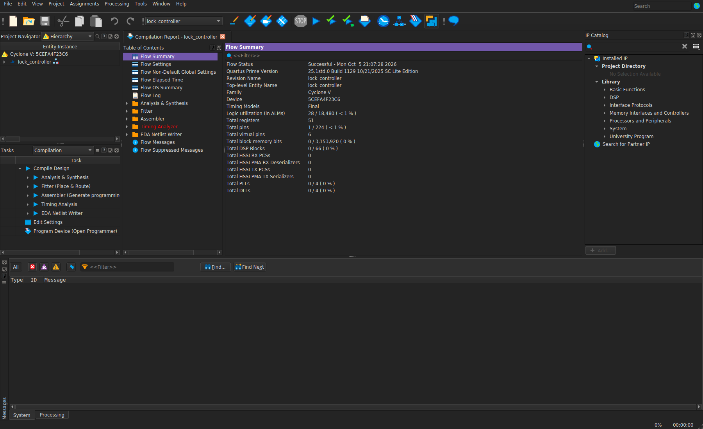

---

**2. Перевірка FSM**

Тут зображено правильну послідовність і помилки на різних кроках.
Видно переходи LOCKED → WAIT_D2 → WAIT_D3 → UNLOCKED,
повернення у LOCKED після неправильної цифри та `unlocked_led`.
Після відкриття замок лишається відкритим до reset.
Перевірив також reset між фронтами clock та утримання введеної цифри.

Нуль означає відпущені кнопки. Утримання попередньої цифри не скидає FSM,
а нова неправильна цифра повертає її у LOCKED.
Тестбенч завершився без помилок: 13 перевірок,
`ALL_TESTS_PASSED = 1`.

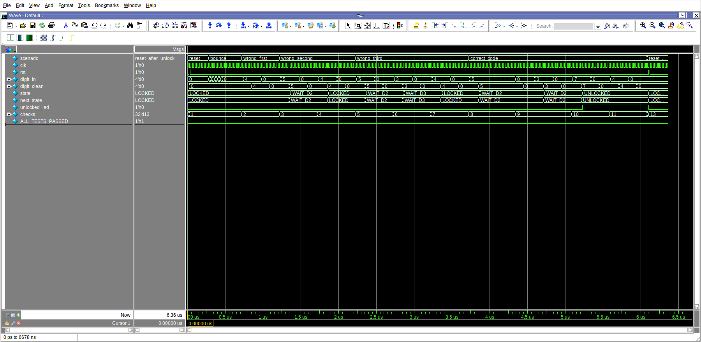

---

**3. Перевірка debounce**

Тут збільшена ділянка зі швидким перемиканням `digit_in` між 5 і 0,
але `digit_clean` лишається нулем і FSM не переходить у WAIT_D2.
Фільтр приймає цифру тільки після стабільного значення.

За замовчуванням це 500000 тактів, приблизно 10 ms при 50 MHz.
У тестбенчі задав 4 такти, щоб швидко перевірити ту саму логіку.
Перед фільтром є два регістри синхронізації входу.

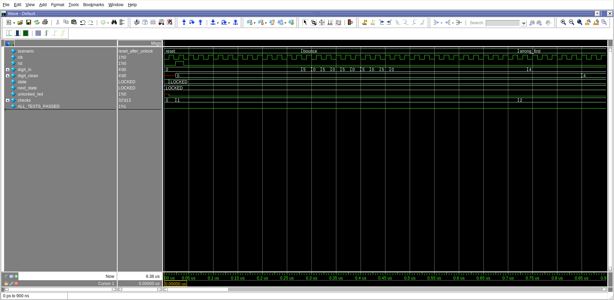

---

**4. Окремий проєкт ALU**

ALU має порти з лекційного прикладу, регістри `a_reg`, `b_reg`, `op_reg`
і регістровий результат. Операції: `00` — додавання, `01` — віднімання,
`10` — AND, `11` — OR. При `oe = 0` результат стає нулем
із урахуванням затримки регістрів. Результат 4-бітний, тому переповнення
і віднімання нижче нуля працюють за модулем 16.

Тут повна компіляція окремого проєкту ALU:
Successful, 15 ALM і 15 регістрів.

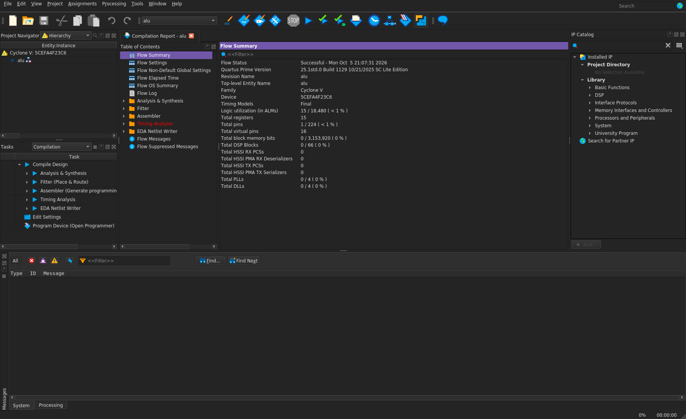

---

**5. Timing для ALU**

У `part2_alu/timing.sdc` рівно один рядок:

```tcl
create_clock -period 10.000 -name sys_clk [get_ports clk]
```

Тут видно найгірший setup slack **+7,047 ns**, hold **+0,135 ns**.
Це результат після Fitter, а не тільки синтезу.

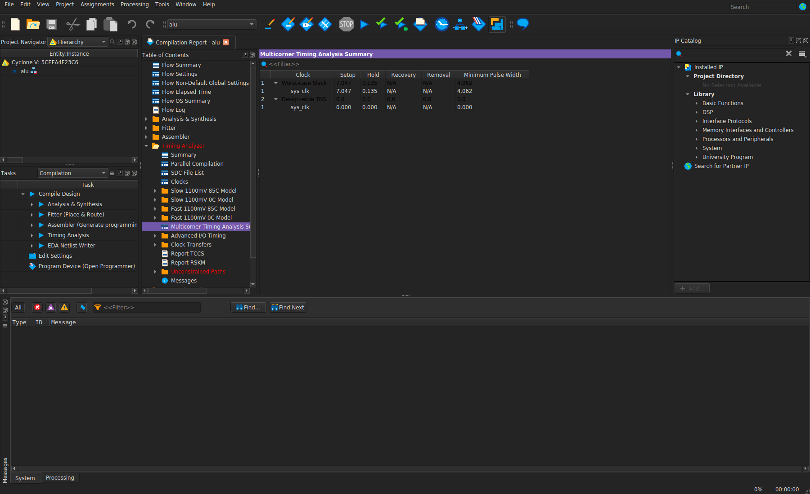

---

**6. Симуляція ALU**

Тут видно всі чотири операції, переповнення, `oe`, reset і проходження
значень через вхідні регістри. Окремо перевірив затримку результату:
на першому фронті захоплюються входи, на наступному з'являється результат.
Тестбенч завершився без помилок: 11 перевірок.

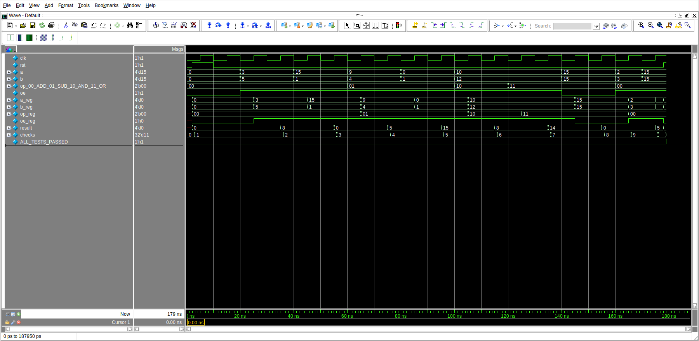

---

**7. Вираз без конвеєра**

В обох варіантах рахується той самий вираз:

```text
result = a*b + c*d + a*c + b*d
```

Входи 16-бітні, результат 32-бітний. Входи спочатку записуються в регістри.
У plain множення і додавання виконуються в одному шляху до вихідного регістра.
У pipeline між множенням і сумою є проміжні регістри добутків.

Тут зображено повну компіляцію plain. Регістрів у рядку Total registers
показано 0, бо Fitter розмістив їх усередині DSP; у RTL вхідні
та вихідний регістри є. Обидва проєкти використовують по 3 DSP-блоки.

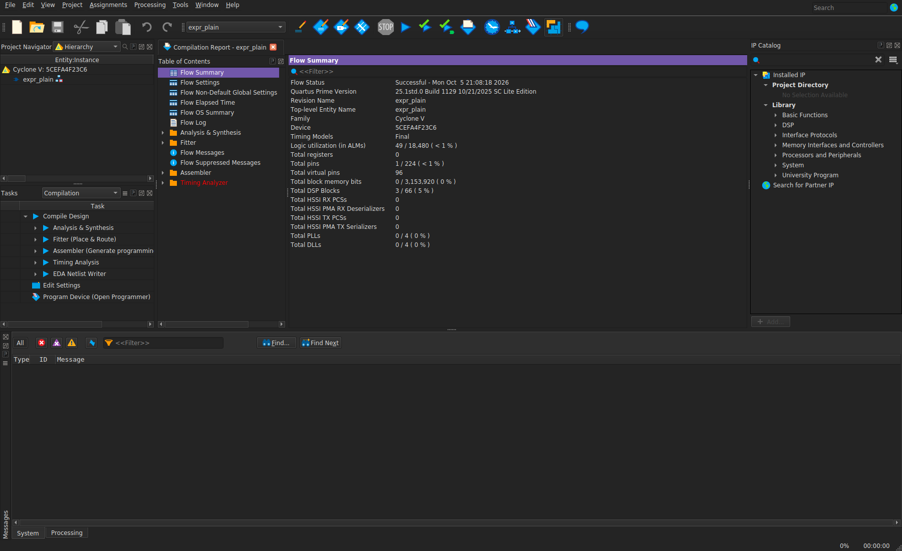

---

**8. Негативний slack до конвеєра**

Для обох проєктів підібрав однаковий період **8,750 ns**,
приблизно 114,286 MHz. В обох SDC рівно один рядок:

```tcl
create_clock -period 8.750 -name sys_clk [get_ports clk]
```

На скріні видно setup slack **−0,612 ns**.
Тобто шлях plain не встигає за заданий період.
Попередження `Timing requirements not met` тут очікуване:
для цієї частини якраз потрібен негативний результат.

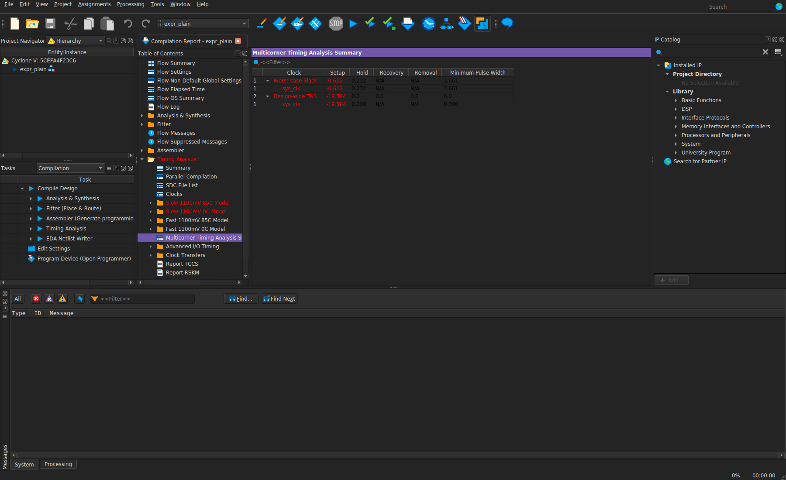

---

**9. Проєкт із конвеєром**

Тут окремий проєкт для `expr_pipelined.sv`.
Множення записуються в проміжні регістри, сума рахується на наступній стадії.
Повна компіляція завершилась успішно.

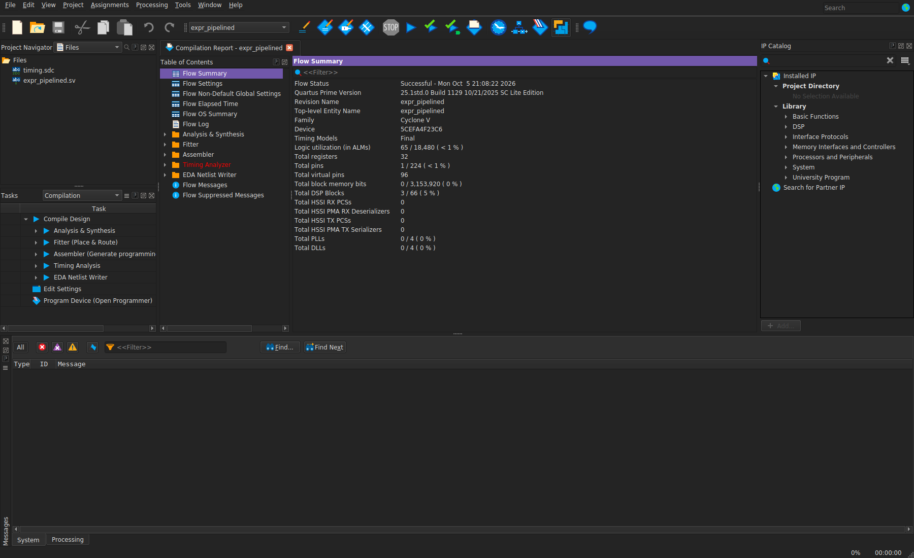

---

**10. Позитивний slack після конвеєра**

На тій самій частоті найгірший setup slack став **+4,152 ns**.
Тобто після розділення обчислень шлях вкладається у заданий період.

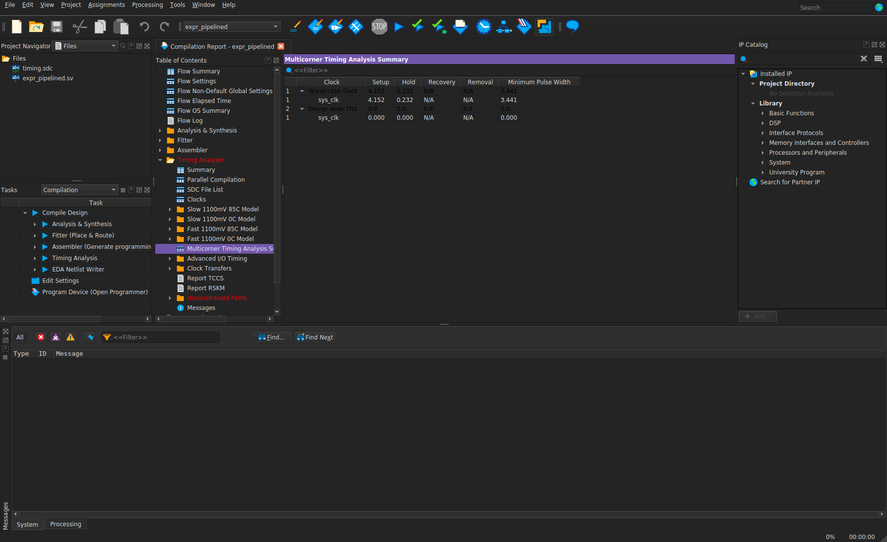

---

**11. Порівняння результатів двох варіантів**

Спільний `tb_expr.sv` лежить у `part3_pipeline/` та підключає обидва модулі.
На скріні збільшив початок симуляції: видно однакові результати,
але pipeline видає їх на такт пізніше. Від захоплення входів до результату
plain має два регістрові рівні, pipeline — три.
Після заповнення обидва варіанти приймають нові дані кожного такту.

Перевірив прості значення, максимальні 16-бітні входи та різні входи кожного такту.
Еталон рахується з ширшою арифметикою, потім беруться нижні 32 біти,
як у RTL. Усього 72 парні перевірки без помилок.
У колонці значень видно кінцеві `checks = 72` та `ALL_TESTS_PASSED = 1`.

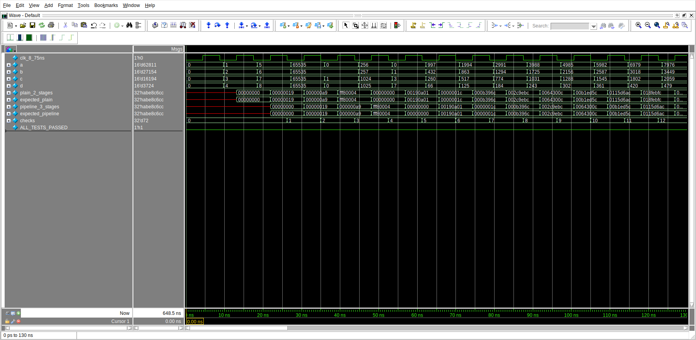

---

**12. Підсумкові числа**

| Проєкт | Період clock | Найгірший setup slack | Найгірший hold slack |
|---|---:|---:|---:|
| Lock controller | 20,000 ns | +16,899 ns | +0,124 ns |
| ALU | 10,000 ns | +7,047 ns | +0,135 ns |
| Expression plain | 8,750 ns | −0,612 ns | +0,232 ns |
| Expression pipeline | 8,750 ns | +4,152 ns | +0,232 ns |

Значення взяті з Multicorner Timing Analysis Summary після повної компіляції.
Піни даних задані як virtual pins, бо це перевірка без плати.
SDC містить лише clock за умовою завдання, тому зовнішні I/O-шляхи
не мають input/output delay і Quartus показує Unconstrained Paths.
Таблиця стосується внутрішніх тактових шляхів; це не перевірка timing інтерфейсу плати.

Логи компіляції, STA-звіти, логи симуляції та збережені waveform `.wlf`
лежать у `evidence/` відповідних проєктів.
